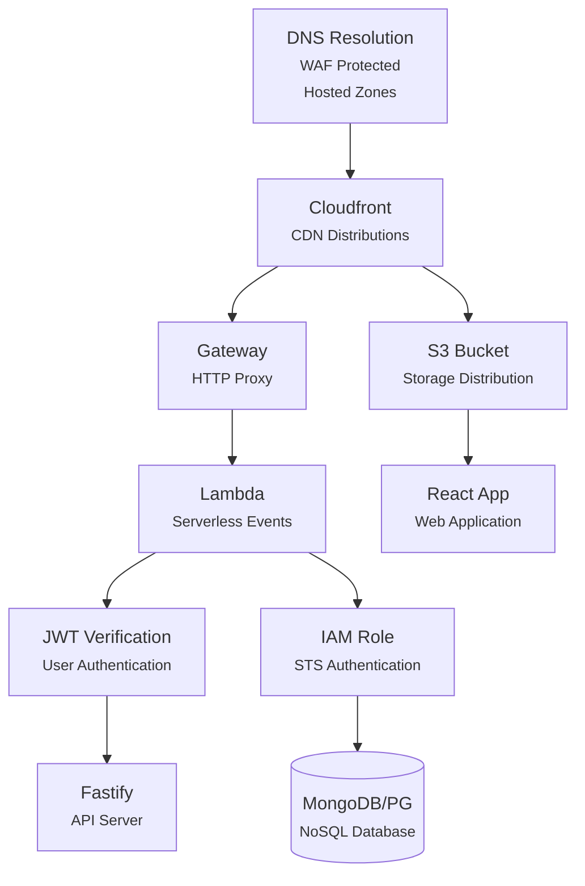

### [matangbr/fnx](https://github.com/MatanGbr/fnx)
מערכת לניהול פניות
a project to...


**Monorepo Structure**
* `@fnx/app`

front-end React application
[fnx.matang.app](https://fnx.matang.app)


* `@fnx/api`<br/>
back-end Fastify API server 
**` curl api.fnx.matang.app`**


**External Services**
* MongoDB
NoSQL Database
**` mongosh \c`**
**` mongosh \c`**
**` mongosh \c`**


#### Run locally

`$ npm install` at the root

```
$ npm install
```

`$ npm run dev` to start on local server


#### Dependency


#### Deployment



