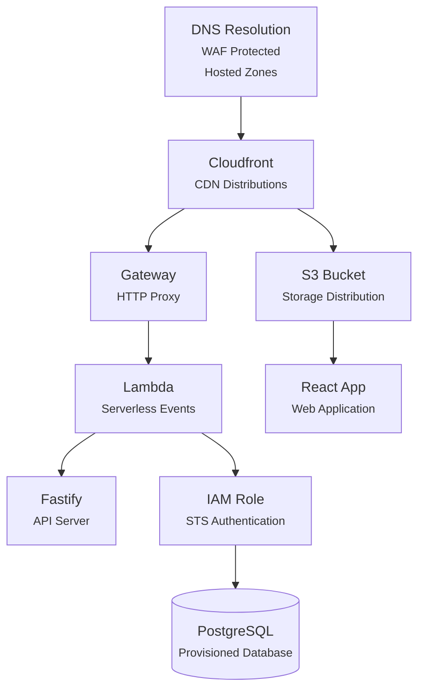

## matangbr/fnx

**מערכת לדוגמה לניהול פניות**

**Monorepo structure**
* `@fnx/app`
<br/> Front-end React application
<br/> [fnx.matang.app](https://fnx.matang.app)


* `@fnx/api`
<br/> Back-end Fastify API server 
<br/> **` curl api.fnx.matang.app`**


* `@fnx/shared`
<br/> For shared validations

**External services**
* **PostgreSQL**
<br/> Primary database
<br/> **` ssh fnx@pg.matang.app `**

**Run it yourself!**

```sh
git clone https://github.com/MatanGbr/fnx.git &&
cd fnx &&
export LOCAL_API=true &&
npm install &&
npm run dev
```

If you also want a local database:

```sh
export LOCAL_DB=true && export FNX_DB_PASSWORD=fnx-local
docker compose up -d --wait db
npm run dev
```

Or to run the API in a container:

```sh
docker compose --profile api up -d --build --wait api
npm run dev:app
```

**About this project**


The system displays tickets streamed into it upon launch, creating a new ticket, or using the search bar (which can filter the results by status). The search bar enables keyboard-only usage (`Tab` focuses, `Esc` cleans, and `Enter` submits) and saves your last search query locally (just like it saves your unfinished ticket values if you accidently closed the tab). It can even tolerate typos thanks to Fuse.js

In the main dataset, a change in "status" triggers an immidiete API call that updates the database, which in turn, triggers a browser event that dynamically updates all of the open systems with the new value (hence the connection indicator).

These broadcasting methods are natively supported and communicate with Fastify, which uses a binary tree to quickly find each route, and a built-in JSON serialization to parse objects as they come. And as data flows between the headless services, Zod validates it and its schemas are compiled at the API statup, or as a lazy background job in the front-end.

Zustand is the tiny state-manager that handles our front-end application's state. Sass modules keep the style scooped, and Vite packages them neatly for production. While the server can operate or be packaged using any JavaScript package manager (npm, pnpm, deno or bun), you can also start it as a containrized Docker image.

The database is indexed for retrieving tickets in newest-first order. A composite index on `(created_at DESC, id DESC)` supports sorting and provides consistent ordering when multiple tickets share the same creation timestamp. If you don't want to connect with my database, you can either run the SQL files in your own database, or just run the PG Docker container.


#### How I deployed it




#### Any feedback? [matangbr@gmail.com](mailto:matangbr@gmail.com)
